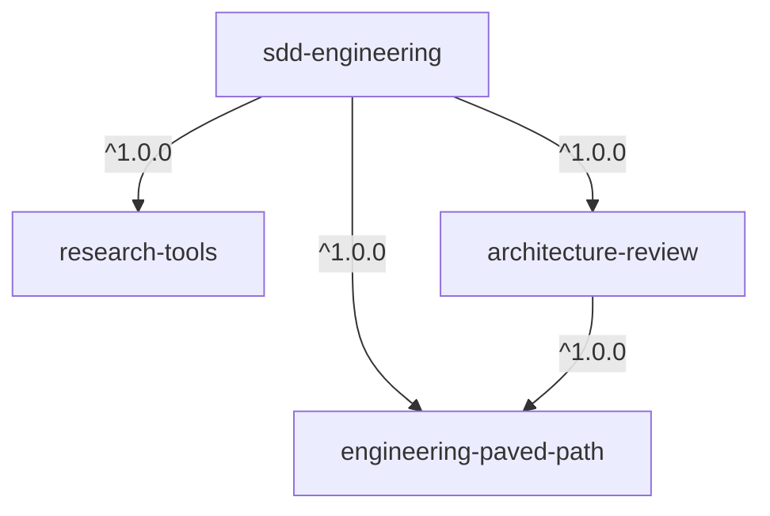

# AI Engineering Marketplace

A [Claude Code plugin marketplace](https://code.claude.com/docs/en/plugins/create-marketplace)
for Spec-Driven Development: agents that write specs, plan, implement and verify
work, plus the engineering skills and reviewers they rely on. Every plugin is
project-agnostic — project-specific settings live in your repository's
`.claude/sdd.json`.

> [!WARNING]
> **Plugins run code on your machine.** Hooks execute shell commands and MCP
> servers start local processes with your permissions. Read a plugin's README and
> its `hooks/` and `.mcp.json` before installing it. See [docs/SECURITY.md](docs/SECURITY.md).

## Install

This repository is private, so Claude Code uses your machine's git credentials.
For HTTPS, set up the GitHub CLI credential helper once:

```bash
gh auth login
gh auth setup-git
```

Then, inside Claude Code:

```text
/plugin marketplace add humen-dev/dev-digest-ai-marketplace
/plugin install <plugin-name>@dev-digest-ai-marketplace
```

Or from a shell:

```bash
claude plugin marketplace add humen-dev/dev-digest-ai-marketplace
claude plugin install <plugin-name>@dev-digest-ai-marketplace
```

### Share with a project

To make the marketplace available to everyone who opens a project, add it at
project scope (writes `extraKnownMarketplaces` to `.claude/settings.json`):

```bash
claude plugin marketplace add humen-dev/dev-digest-ai-marketplace --scope project
```

### Updates

Auto-update is **off** by default for third-party marketplaces. Update manually:

```text
/plugin marketplace update dev-digest-ai-marketplace
```

or enable auto-update in `/plugin` → Marketplaces. After an update, run
`/reload-plugins` (or restart) to load the new version.

## Plugins

| Plugin | Kind | What it adds |
|--------|------|--------------|
| [`sdd-engineering`](plugins/sdd-engineering/) | product | Spec-Driven Development: `spec-creator`, `implementation-planner`, `implementer`, `plan-verifier` agents; `/sdd-engineering:run-plan`, `/sdd-engineering:workflow-retro`; guard hooks |
| [`engineering-paved-path`](plugins/engineering-paved-path/) | dependency | 12 engineering skills: React, Next.js, Fastify, Drizzle, PostgreSQL, TypeScript, Zod, testing, security, architecture, Mermaid |
| [`research-tools`](plugins/research-tools/) | dependency | read-only `researcher` agent |
| [`architecture-review`](plugins/architecture-review/) | dependency | read-only `architecture-reviewer` agent + Bash guard |



Installing `sdd-engineering` installs its dependencies automatically.

## Repository layout

```text
.claude-plugin/marketplace.json   catalog of plugins
plugins/<name>/                   one folder per plugin
docs/PLUGIN-GUIDELINES.md         how to structure a plugin
docs/SECURITY.md                  hooks, MCP and secrets policy
docs/RELEASES.md                  versioning, updates, rollback
scripts/validate-marketplace.mjs  structural linter (no dependencies)
```

## Develop locally

```bash
# add this checkout as a local marketplace (plugins load in place)
claude plugin marketplace add ./
claude plugin install <plugin-name>@dev-digest-ai-marketplace

# after editing a plugin, inside Claude Code
/reload-plugins

# checks that CI runs
node scripts/validate-marketplace.mjs
claude plugin validate . --strict
```

See [CONTRIBUTING.md](CONTRIBUTING.md) before adding or changing a plugin.
