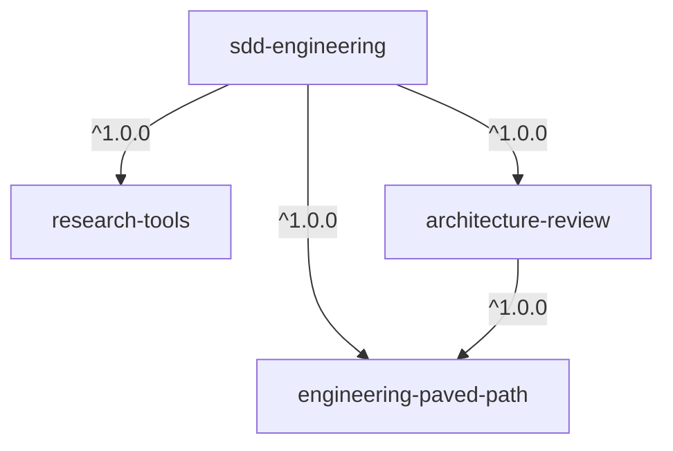

# Spec: SDD engineering plugins

| | |
|---|---|
| Status | Draft |
| Owner | @humen-dev |
| Created | 2026-10-14 |
| Source | [humen-dev/dev-digest](https://github.com/humen-dev/dev-digest) `.claude/agents`, `.claude/skills`, `.claude/hooks`, `evals/`, `docs/sdd-workflow.md` |

## 1. Summary

Package the DevDigest Spec-Driven Development (SDD) workflow as four plugins in
this marketplace, so any project can run *spec → plan → waves → verify → retro*
without copying `.claude/` folders.

- **One product plugin** — `sdd-engineering` — holds the workflow: four agents,
  the `run-plan` and `workflow-retro` skills, guard hooks, evals and docs.
- **Three reusable dependency plugins** — `engineering-paved-path`,
  `research-tools`, `architecture-review` — hold pieces that are useful on their
  own and are shared by other plugins.

## 2. Goals and non-goals

### Goals

- G1. `claude plugin install sdd-engineering@dev-digest-ai-marketplace` installs
  the whole workflow, dependencies included.
- G2. No DevDigest paths, packages or commands are hard-coded. Everything
  project-specific is an explicit input (§6).
- G3. Each dependency plugin is useful without `sdd-engineering`.
- G4. `sdd-engineering/README.md` explains how the parts work together;
  `sdd-engineering/RELEASES.md` records every version.

### Non-goals

- Product specs, plans, retros and run state of DevDigest — they stay in dev-digest.
- Secrets, caches, `.claude/.impl/`, `.claude/.retro/`, `settings.local.json`.
- DevDigest-specific instructions (package names `server/`, `client/`,
  `reviewer-core`, `scripts/agent-check.mjs`, `AGENTS.md`/`INSIGHTS.md` rules).
- Other DevDigest agents: `brainstormer`, `test-writer`, `doc-writer`,
  `security-reviewer`, `architecture-reviewer-lite`, and the `pr-self-review`,
  `engineering-insights`, `dependency-checker` skills. Candidates for later plugins.

## 3. Plugins and contents

### 3.1 `engineering-paved-path` (dependency)

Coding-practice skills preloaded by planners, implementers and reviewers.
Mirrors the course layout: our own skills **plus** the third-party skills that
dev-digest installed from other repositories (`skills-lock.json`).

| Skill | DevDigest source | Origin | Licence |
|---|---|---|---|
| `react-best-practices` | `.claude/skills/react-best-practices` | own | — |
| `react-testing-library` | `.claude/skills/react-testing-library` | own | — |
| `security` | `.claude/skills/security` | own | — |
| `onion-architecture` | `.claude/skills/onion-architecture` | own — generalise | — |
| `frontend-ui-architecture` | `.claude/skills/frontend-ui-architecture` | own — generalise | — |
| `mermaid-diagram` | `.claude/skills/mermaid-diagram` | own; preloaded by `spec-creator` | — |
| `next-best-practices` | `.claude/skills/next-best-practices` | vercel-labs/next-skills (now moved to vercel/next.js `skills/`) | none declared — see §9 |
| `fastify-best-practices` | `.claude/skills/fastify-best-practices` | mcollina/skills | MIT |
| `drizzle-orm-patterns` | `.claude/skills/drizzle-orm-patterns` | giuseppe-trisciuoglio/developer-kit | MIT |
| `postgresql-table-design` | `.claude/skills/postgresql-table-design` | wshobson/agents | MIT |
| `typescript-expert` | `.claude/skills/typescript-expert` | sickn33/antigravity-awesome-skills | MIT |
| `zod` | `.claude/skills/zod` | pproenca/dot-skills | MIT |

Third-party skills are copied **unchanged** from the dev-digest copy (pinned by
the hashes in `skills-lock.json`). `THIRD_PARTY_NOTICES.md` in the plugin lists
each one with its source repository, commit/hash, copyright holder and full
licence text, as MIT requires. Local edits, if ever needed, are noted there too.

### 3.2 `research-tools` (dependency)

| Component | Source |
|---|---|
| agent `researcher` | `.claude/agents/researcher.md` |

Already read-only and nearly generic; replace the `AGENTS.md`/`INSIGHTS.md`/`server/`
mentions with "the project's agent docs, if any".

### 3.3 `architecture-review` (dependency)

| Component | Source |
|---|---|
| agent `architecture-reviewer` (generalised) | `.claude/agents/architecture-reviewer.md` |
| hook: read-only Bash guard for this agent | `.claude/hooks/bash-scope-guard.mjs` (subset) |

Generalisation: the reviewer judges placement against the architecture skills of
`engineering-paved-path` and the project's own architecture docs. It runs the
project's dependency checker **only if configured** (§6: `architectureCheck`);
otherwise it reports "no automated check" instead of assuming dependency-cruiser.

### 3.4 `sdd-engineering` (product)

| Component | Source | Notes |
|---|---|---|
| agent `spec-creator` | `agents/spec-creator.md` | writes only in `specsDir` |
| agent `implementation-planner` | `agents/implementation-planner.md` | writes only in `plansDir` |
| agent `implementer` | `agents/implementer.md` + `-backend` + `-ui` | **merged into one** — see §5.3 |
| agent `plan-verifier` | `agents/plan-verifier.md` | read-only + allow-listed checks |
| skill `run-plan` | `skills/impl` (renamed from `/impl`) | `/sdd-engineering:run-plan <plan>` |
| skill `workflow-retro` | `skills/workflow-retro` | `/sdd-engineering:workflow-retro` |
| skill `ears-requirements` | `skills/ears-requirements` | SDD-only; drop the DevDigest system names |
| hooks | `hooks/write-scope-guard.mjs`, `bash-scope-guard.mjs`, `implementation-planner-write-guard.mjs`, `lib/` | rewritten as plugin hooks — §5.2 |
| spec template | `specs/_TEMPLATE.md` | shipped as `templates/spec.md` |
| plan template | (implicit in planner prompt) | shipped as `templates/plan.md` |
| evals | `evals/` (relevant cases) | ported to `claude plugin eval` format |
| `README.md` | `docs/sdd-workflow.md` (condensed) | how the parts work together |
| `RELEASES.md` | new | changelog per version |

Skill placement rule: `sdd-engineering` contains **only our own skills that
exist solely for the SDD flow** — `run-plan`, `workflow-retro`,
`ears-requirements`. Any skill useful outside SDD (e.g. `mermaid-diagram`, also
used by DevDigest's `doc-writer`) goes to `engineering-paved-path`. Third-party
skills live only in `engineering-paved-path`, never in `sdd-engineering`.

## 4. Dependency graph



`architecture-review → engineering-paved-path` is an addition to the course
slides: the reviewer preloads `onion-architecture` and `frontend-ui-architecture`,
which live in `engineering-paved-path`.

`sdd-engineering/.claude-plugin/plugin.json`:

```json
{
  "name": "sdd-engineering",
  "version": "1.0.0",
  "dependencies": [
    { "name": "engineering-paved-path", "version": "^1.0.0" },
    { "name": "research-tools", "version": "^1.0.0" },
    { "name": "architecture-review", "version": "^1.0.0" }
  ]
}
```

`dependencies` is an **array** (string or `{name, version, marketplace}`), not a map.
Installing a plugin installs and enables its dependencies at the same scope.

## 5. Packaging rules

### 5.1 Repository layout

```text
plugins/
├── engineering-paved-path/
│   ├── .claude-plugin/plugin.json
│   ├── skills/<12 skills>/SKILL.md (+ their reference files)
│   ├── THIRD_PARTY_NOTICES.md
│   └── README.md
├── research-tools/
│   ├── .claude-plugin/plugin.json
│   ├── agents/researcher.md
│   └── README.md
├── architecture-review/
│   ├── .claude-plugin/plugin.json
│   ├── agents/architecture-reviewer.md
│   ├── hooks/hooks.json
│   ├── scripts/bash-guard.mjs
│   └── README.md
└── sdd-engineering/
    ├── .claude-plugin/plugin.json
    ├── agents/{spec-creator,implementation-planner,implementer,plan-verifier}.md
    ├── skills/{run-plan,workflow-retro,ears-requirements}/
    ├── hooks/hooks.json
    ├── scripts/{write-guard,bash-guard}.mjs, scripts/lib/
    ├── templates/{spec,plan}.md
    ├── evals/
    ├── README.md
    └── RELEASES.md
```

### 5.2 Hooks move from agent frontmatter to plugin hooks

Plugin agents **ignore** `hooks`, `mcpServers` and `permissionMode` in
frontmatter. The per-agent guards therefore become plugin-level
`hooks/hooks.json` entries:

- `PreToolUse` with matcher `Write|Edit` → `node "${CLAUDE_PLUGIN_ROOT}/scripts/write-guard.mjs"`
- `PreToolUse` with matcher `Bash` → `node "${CLAUDE_PLUGIN_ROOT}/scripts/bash-guard.mjs"`

Plugin hooks fire in **every** session and subagent where the plugin is enabled.
Each script reads `agent_type` from the hook's stdin JSON and:

- exits 0 immediately unless `agent_type` is one of its agents
  (`sdd-engineering:spec-creator`, `sdd-engineering:implementation-planner`,
  `sdd-engineering:implementer`, `sdd-engineering:plan-verifier`,
  `architecture-review:architecture-reviewer`);
- otherwise applies that agent's allow-list and exits 2 to block.

Hooks are Node scripts called through `node` (no execute bit, no CRLF issues).

### 5.3 One `implementer` instead of three

The course packs four agents. `implementer-backend` and `implementer-ui` differ
from `implementer` only in preloaded skills. Merged agent:

- preloads only `engineering-paved-path:security` and `engineering-paved-path:typescript-expert`;
- reads the skills listed in its plan unit's **Skills** field on demand
  (`Read` of the skill file), so the plan — not the agent — decides the stack.

`implementation-planner` keeps preloading the full paved-path set, so it only
plans with practices an implementer can apply.

### 5.4 Names and paths

- Agents are invoked as `<plugin>:<agent>` — `run-plan` dispatches
  `sdd-engineering:implementer`, `sdd-engineering:plan-verifier`,
  `architecture-review:architecture-reviewer`, `research-tools:researcher`.
- Skills from another plugin are referenced namespaced in agent `skills:`
  frontmatter: `engineering-paved-path:react-best-practices`. Verified by a
  spike on Claude Code 2.1.299: a plugin agent preloads a skill from another
  plugin both by namespaced and by bare name; we always use the namespaced form.
- Plugin hooks receive `agent_type` as `<plugin>:<agent>` (verified by the same
  spike), so per-agent guards (§5.2) are reliable.
- Supporting scripts are found via `${CLAUDE_SKILL_DIR}` (skill's own folder) or
  `${CLAUDE_PLUGIN_ROOT}` (shared plugin files), never `.claude/skills/…`.
  These are substituted in `SKILL.md` content and `allowed-tools`, **not** in the
  Bash environment — always write the `${…}` in the Markdown.
- `run-plan` and `workflow-retro` keep `disable-model-invocation: true`
  (manual only; this also prevents preloading them into subagents).
- Run state (`.claude/.impl/<slug>/`, `.claude/.retro/`) moves to the project's
  `.sdd/` folder (git-ignored), because it belongs to the project, not the plugin.

### 5.5 Project-agnostic content

Every agent, skill, hook, template and README in these plugins is public and
must work in any repository:

- No DevDigest names, package names (`server/`, `client/`, `reviewer-core`,
  `e2e/`, `mcp/`), scripts (`agent-check.mjs`, `dev.sh`), repository URLs,
  or paths into a specific checkout (`.claude/skills/…`, `.claude/hooks/…`,
  `$CLAUDE_PROJECT_DIR/.claude/…`).
- Project-specific values come from `.claude/sdd.json` (§6) or from the
  caller's prompt. Agents refer to them by key ("the plans directory"), not by path.
- Examples inside skills use a neutral sample application. Architecture skills
  (`onion-architecture`, `frontend-ui-architecture`) describe the pattern and
  map it onto "your project's" folders instead of DevDigest modules.
- The project's own agent docs (`AGENTS.md`, `CLAUDE.md`, …) are read only if
  present and listed in `agentDocs`.
- Third-party skills stay byte-identical to upstream; attribution lives only in
  `THIRD_PARTY_NOTICES.md`.

### 5.6 Plugin READMEs

Each plugin ships a `README.md` with: what it is for; install command (and that
dependencies install automatically); every agent / skill / hook with when to use
it and how to invoke it (`/plugin:skill`, `plugin:agent`); configuration
(`.claude/sdd.json` keys it reads); what hooks run and why; dependencies and
dependents. `sdd-engineering/README.md` additionally holds the end-to-end flow
diagram (spec → plan → waves → verify → retro), the role of each agent, the
artifacts each step writes, and a worked example.

## 6. Project inputs (replacing DevDigest paths)

`run-plan` and the agents read an optional `.claude/sdd.json` in the user's
project. Missing keys use defaults; `run-plan` asks once if a required value has
no default.

| Key | Default | Replaces in DevDigest |
|---|---|---|
| `specsDir` | `specs/` | `<pkg>/specs/`, `specs/` |
| `specTemplate` | plugin `templates/spec.md` | `specs/_TEMPLATE.md` |
| `plansDir` | `docs/plans/` | `docs/plans/` |
| `checkCommand` | — (asked) | `node scripts/agent-check.mjs <pkg> …` |
| `architectureCheck` | none | `npx depcruise …` |
| `modules` | `[{ "name": "root", "path": "." }]` | `server`, `client`, `reviewer-core`, `e2e`, `mcp` |
| `agentDocs` | `["AGENTS.md", "CLAUDE.md"]` if present | `AGENTS.md`, `INSIGHTS.md` |

Hooks read the same file to know which folders each agent may write.

DevDigest itself then uninstalls nothing: it keeps its project agents, or adds a
`.claude/sdd.json` with its current paths and switches to the plugin.

## 7. Versioning

Dependency ranges (`^1.0.0`) resolve against git tags `<plugin>--v<version>`, so
all four plugins use **SemVer from day one** (Mode B in `docs/RELEASES.md`):

- `version` set in each `plugin.json` only; start at `1.0.0`.
- After merge: `claude plugin tag plugins/<name> --push` for every bumped plugin.
- `sdd-engineering/RELEASES.md` records each version: date, changes, required
  dependency ranges.
- This triggers the "Planned automation" in `docs/RELEASES.md`
  (`bump-version`, auto-tag workflow, `rollback`).

## 8. Acceptance criteria

- AC1. `node scripts/validate-marketplace.mjs` and `claude plugin validate . --strict`
  pass with all four plugins.
- AC2. In a clean project, `claude plugin install sdd-engineering@dev-digest-ai-marketplace`
  also installs the three dependencies.
- AC3. `grep -rniE "devdigest|dev-digest|reviewer-core|agent-check|.claude/(skills|hooks|agents)/|CLAUDE_PROJECT_DIR/.claude" plugins/ | grep -v "dev-digest-ai-marketplace"`
  finds nothing outside `THIRD_PARTY_NOTICES.md` (§5.5). The marketplace name
  itself (`@dev-digest-ai-marketplace` in install commands) is allowed.
- AC4. `spec-creator` cannot write outside `specsDir`; `implementation-planner`
  outside `plansDir`; `plan-verifier` and `architecture-reviewer` cannot run
  non-allow-listed Bash — each proven by a hook unit test and one live try.
- AC5. The guard hooks do nothing for the main session and for agents of other plugins.
- AC6. `/sdd-engineering:run-plan` runs a small plan end to end on a sample repo:
  waves, `plan-verifier` after each wave, architecture review, commits.
- AC7. `claude plugin eval` passes for the ported eval cases.
- AC8. Each plugin has a README; `sdd-engineering/README.md` contains the flow
  diagram and the role of every agent and skill.

## 9. Decisions for v1 (were open questions)

Defaults taken to start implementation; each can be revisited in a later version.

1. **Review loop of `run-plan`** — `plan-verifier` after every wave, then
   `architecture-review:architecture-reviewer` and a bugs review by a
   general-purpose subagent. No `security-reviewer` in v1 (candidate for a
   future `security-review` dependency plugin).
2. **Evals** — `architecture-review` ports the DevDigest
   `evals/agents/architecture-reviewer` cases (fixtures made project-neutral) to
   `claude plugin eval`. `sdd-engineering` ships a small smoke suite
   (spec-creator interview, plan-verifier verdict). Other DevDigest evals stay
   in DevDigest.
3. **Implementers** — merged into one `implementer` (§5.3).
4. **`next-best-practices`** — copied as-is while the repo is private. Upstream
   (`vercel-labs/next-skills`) declares no licence and retired this skill in favour
   of the docs bundled with Next.js; `vercel/next.js/skills` has only workflow
   skills, so there is no MIT drop-in. Before the repo goes public the owner picks
   one: drop it and point to Next.js bundled docs, substitute an MIT workflow skill
   from `vercel/next.js/skills`, or get Vercel's permission. Details in
   `plugins/engineering-paved-path/THIRD_PARTY_NOTICES.md`.
