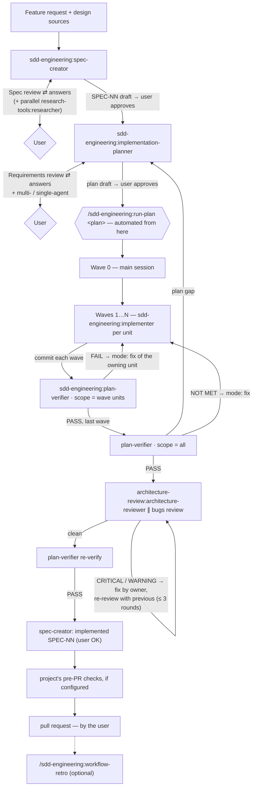

# sdd-engineering

A **Spec-Driven Development (SDD)** workflow for Claude Code: a feature goes from
an idea to a reviewed, committed branch through four agents, two manual skills
and two guard hooks — *spec → plan → waves → verify → review → retro* — in any
repository, without copying `.claude/` folders between projects.

| Component | Type | Invoke as |
|---|---|---|
| `spec-creator` | agent | `sdd-engineering:spec-creator` |
| `implementation-planner` | agent | `sdd-engineering:implementation-planner` |
| `implementer` | agent | `sdd-engineering:implementer` (normally dispatched by `run-plan`) |
| `plan-verifier` | agent | `sdd-engineering:plan-verifier` |
| `run-plan` | skill (manual) | `/sdd-engineering:run-plan <plan> …` |
| `workflow-retro` | skill (manual) | `/sdd-engineering:workflow-retro …` |
| `ears-requirements` | skill (preloaded by the spec and plan agents) | `sdd-engineering:ears-requirements` |
| write guard | `PreToolUse` hook (`Write\|Edit`) | automatic — see [Guard hooks](#guard-hooks) |
| Bash guard | `PreToolUse` hook (`Bash`) | automatic — see [Guard hooks](#guard-hooks) |
| version trace | `SessionStart` / `SubagentStart` hook | automatic — see [Version trace](#version-trace) |
| templates | `templates/spec.md`, `templates/plan.md` | used by the agents |
| eval suite | `evals/` | see [Dependencies, evals, versions](#dependencies-evals-versions) |

## Contents

1. [What SDD means here](#what-sdd-means-here)
2. [Install](#install)
3. [Quick start](#quick-start)
4. [Project configuration — `.claude/sdd.json`](#project-configuration--claudesddjson)
5. [The flow](#the-flow)
6. [Agents](#agents)
7. [Skills](#skills)
8. [Guard hooks](#guard-hooks)
9. [Version trace](#version-trace)
10. [Artifacts map](#artifacts-map)
11. [Worked example](#worked-example)
12. [Cost and when to skip steps](#cost-and-when-to-skip-steps)
13. [Troubleshooting](#troubleshooting)
14. [Dependencies, evals, versions](#dependencies-evals-versions)

## What SDD means here

Three ideas carry the whole process:

- **What before how.** A *spec* fixes **what** the system must do — EARS
  acceptance criteria (`WHEN … the API shall …`), edge cases, NFRs, untrusted
  inputs. A *plan* decides **how** — files, work units, contracts, waves.
  Neither agent does the other's job, and both stop to ask before writing.
- **Parallel by construction.** The plan splits work into units with disjoint
  file ownership and shared contracts produced first, so several implementers
  can edit one checkout at the same time.
- **Nothing is trusted, everything is verified.** Implementer reports are
  claims. After every wave a read-only verifier checks the code against the
  plan item by item (and at the end against the spec); reviewers then look for
  placement problems and bugs; fixes are routed back to the unit that owns the
  file.

The user decides at three points: answering the spec questions and approving
the spec, answering the plan questions and approving the plan, and acting on
anything `run-plan` escalates (budgets, disputes, pushing, the pull request).

## Install

```bash
claude plugin marketplace add humen-dev/dev-digest-ai-marketplace
claude plugin install sdd-engineering@dev-digest-ai-marketplace
```

Dependencies install and enable automatically at the same scope:

| Dependency | Range | Why |
|---|---|---|
| [`engineering-paved-path`](../engineering-paved-path/README.md) | `^1.0.0` | coding-practice skills preloaded by the planner and read per unit by the implementer (`engineering-paved-path:<skill>`) |
| [`research-tools`](../research-tools/README.md) | `^1.0.0` | `research-tools:researcher` — runs the spec-creator's research requests |
| [`architecture-review`](../architecture-review/README.md) | `^1.0.0` | `architecture-review:architecture-reviewer` — the placement review in `run-plan` |

Requirements: Node.js ≥ 18 on `PATH` (hooks and helper scripts are plain Node,
no packages), git.

## Quick start

1. Optional but recommended — tell the plugin about your project in
   `.claude/sdd.json` (at least `checkCommand`), and git-ignore the run state:

   ```json
   { "checkCommand": "npm test", "specsDir": "specs/", "plansDir": "docs/plans/" }
   ```

   ```bash
   echo ".sdd/" >> .gitignore
   ```

2. **Spec.** In a Claude Code session:

   > Use the sdd-engineering:spec-creator agent to write a spec for: users can
   > export their invoices as CSV. Design sources: none.

   It replies with a **Spec review** (questions with defaults, findings, UX
   proposals, research requests). Answer, let the main session run the research
   requests, re-invoke with the answers — it writes `specs/YYYY-MM-DD-<slug>.md`
   with status `draft`. Read it; say *"approve SPEC-NN"* when it is right.

3. **Plan.**

   > Use the sdd-engineering:implementation-planner agent to plan SPEC-07
   > (specs/2026-10-14-invoice-export.md).

   It replies with a **Requirements review** and asks for the execution mode
   (`multi-agent` or `single-agent`). Answer; it writes `docs/plans/<slug>.md`
   with status `draft`. Review it and set `Status` to `approved` (or ask the
   planner to).

4. **Build.**

   ```text
   /sdd-engineering:run-plan invoice-export
   ```

   Wave 0, implementer waves, a verifier after every wave, the review loop,
   commits on a `sdd/<slug>` branch. It never pushes or opens a pull request.

5. **Optional retro.** `/sdd-engineering:workflow-retro kind:impl label:invoice-export`.

## Project configuration — `.claude/sdd.json`

Every key is optional; a missing file means all defaults. The agents, the
`run-plan` helper and the guard hooks read the same file, so they always agree.

| Key | Default | Meaning |
|---|---|---|
| `specsDir` | `"specs/"` | Where cross-module specs live (and single-module specs when the module has no `specsDir`). spec-creator may write only here and in module spec folders. |
| `specTemplate` | `null` → the plugin's `templates/spec.md` | Your own spec template (project-relative). spec-creator may never edit it. |
| `plansDir` | `"docs/plans/"` | Where plans live. implementation-planner may write only `*.md` directly in it. |
| `checkCommand` | `null` (asked) | Typecheck + related tests for a unit. Placeholders below. Without it implementers report `BLOCKED: checkCommand not configured` and the verifier marks checks NOT VERIFIABLE; `run-plan` asks once. |
| `architectureCheck` | `null` (none) | An automated architecture/dependency check (`{module}` only). Without it the reviewer reports "no automated check". |
| `modules` | `[{"name":"root","path":".","specsDir":null}]` | Your modules. `name` is what plans put in a unit's *Module* field; `path` is project-relative; `specsDir` (project-relative, or `null`) is that module's own spec folder. |
| `agentDocs` | `["AGENTS.md","CLAUDE.md"]` | Agent docs the agents read if present (root and per module). Nothing in the workflow edits them except an explicit orchestrator unit. |
| `runStateDir` | `".sdd/"` | Run state and saved reports (`run-plan/<slug>/`, `retro/`). Git-ignore it. |

**Command placeholders** (`checkCommand`, `architectureCheck`): commands run
from the project root, never after a `cd`.

- `{module}` → the unit's module `path` (`.` for the root module);
- `{files}` → the unit's owned files in that module, space-separated,
  project-relative; empty → the module's full check (`checkCommand` only);
- no placeholders → the command runs as written.

Keep the commands free of `>`, `<`, `$`, backticks and `&` (the Bash guard
rejects those constructs); wrap anything complex in a script, e.g.
`node scripts/check.mjs {module} {files}`.

Example for a monorepo with an API and a web app:

```json
{
  "specsDir": "specs/",
  "specTemplate": null,
  "plansDir": "docs/plans/",
  "checkCommand": "node scripts/check.mjs {module} {files}",
  "architectureCheck": "node scripts/arch-check.mjs {module}/src --strict",
  "modules": [
    { "name": "api", "path": "services/api", "specsDir": "services/api/specs/" },
    { "name": "web", "path": "apps/web", "specsDir": "apps/web/specs/" }
  ],
  "agentDocs": ["AGENTS.md", "CLAUDE.md"],
  "runStateDir": ".sdd/"
}
```

## The flow



Agents never talk to each other. Every hand-off goes through the main session,
and **subagents cannot start subagents** — when an agent needs another one (the
spec-creator needs research, an implementer needs a contract change), it
returns a request and the main session acts on it.

### Waves

A **wave** is a group of units that can be built at the same time: they do not
depend on each other and do not own the same files. Waves run in order; units
inside a wave run in parallel (multi-agent mode) or one at a time
(single-agent mode).

- **Wave 0** is done by the main session itself: §3 contracts, dependency
  installs, migrations, shared registries, file moves and deletes, agent-doc
  edits. Any unit whose Kind is `orchestrator` is also done by the main session.
- **Waves 1…N:** one `sdd-engineering:implementer` per unit. Each edits only the
  files its unit owns, verifies with `checkCommand`, never touches git, and
  returns an *Implementer result*.
- **After every wave:** the main session commits, then runs the verifier on the
  wave's units. FAIL → the owning unit's implementer in `mode: fix` → commit →
  re-verify (≤ 2 rounds, then the user decides).

### Verification rows

`plan-verifier` turns the plan (and, with `scope: all`, the spec) into rows
before it reads any code; each row gets MET / PARTIAL / NOT MET / NOT
VERIFIABLE with `file:line` or `command → result` evidence.

| Row ID | Source | Meaning |
|---|---|---|
| `C-<name>` | plan §3 | a contract matches the code |
| `U<n>-OWN-<k>` / `U<n>-MNT-<k>` | unit *Owns* / *Must not touch* | owned files changed; forbidden files untouched |
| `U<n>-AC-<k>` / `U<n>-CHK-<k>` | unit acceptance criteria / checks | the criterion holds / the check passes |
| `T-<k>` / `V-<k>` | plan §6 / §7 | the planned test exists and passes / the verification step holds |
| `S<NN>-AC\|EC\|NFR-<k>` | the spec | what the user approved in the spec was built — catches requirements the plan forgot (*plan gap*) |

### Where a failure goes

| Failure | Goes to | Then |
|---|---|---|
| Implementer `BLOCKED:` | main session → user / plan | fix the input, re-run the unit |
| Wave verification FAIL | the owning unit's implementer, `mode: fix` | re-verify |
| Spec row NOT MET, no unit cites it (*plan gap*) | `implementation-planner` with `plan gap: S<NN>-…` | new unit(s) in a new wave; finished units untouched |
| Reviewer CRITICAL / WARNING | the owning unit's implementer (`plan-tools owner`), or the main session | re-review with `previous` (≤ 3 rounds), then re-verify |
| Budget exhausted | the user | accept / fix manually / one more round |
| Spec wrong or incomplete | the user → `spec-creator` (`revise` a draft, or `supersede` an approved spec) | re-plan the affected units |

### Lifecycles

- **Spec:** `draft` → (user: approve) → `approved` → (all spec rows MET + user
  OK) → `implemented`; an approved spec is immutable — a change is a new spec
  that supersedes it.
- **Plan:** `draft` → `approved` (by the user) → `in-progress` → `done`.
- **Wave:** implement → commit → verify → (fix → re-verify)* → PASS.

## Agents

All four agents use **interview mode**: when an input is missing or ambiguous
they return a `Clarification needed` (or their review) block instead of
guessing. Relay the block to the user, then re-invoke the agent with the
original request plus the answers. Invoke an agent in plain words —
*"use the sdd-engineering:spec-creator agent to …"* — or through the Agent tool
with `subagent_type: "sdd-engineering:<agent>"`.

### `sdd-engineering:spec-creator` — what to build

| | |
|---|---|
| Use when | a feature needs a behaviour spec before planning, or a spec must be revised, approved, marked implemented or superseded |
| Model | opus · preloads `sdd-engineering:ears-requirements`, `engineering-paved-path:security`, `engineering-paved-path:mermaid-diagram` |
| Inputs | **feature** (request, brief, ticket) · **mode**: `create` (default) · `revise <spec path>` · `approve SPEC-NN` · `implemented SPEC-NN` · `supersede <spec path>` · **design sources** (text, Figma link **plus exported PNG frames**, code paths, a repository — or "none") · optional `template` (absolute path; default `specTemplate`, else `${CLAUDE_PLUGIN_ROOT}/templates/spec.md`), answers, research reports |
| First reply | a **Spec review**: target folder, proposed file and `SPEC-NN`, findings (gaps, corner cases, module interactions, UX, NFR), UX proposals, ≤ 8 questions with options and defaults, optional **research requests** (the main session runs one `research-tools:researcher` per request, in parallel, and passes the reports back with `revise`) |
| Output | `<specsDir or module specsDir>/YYYY-MM-DD-<slug>.md` — global `SPEC-NN`, EARS acceptance criteria with priority and *Verify by*, edge cases, NFRs, untrusted inputs, traceability, self-check, status `draft` — plus a line in that folder's `README.md` index |
| May write | only `*.md` in the spec folders (hook-enforced), never the template |

Example: *"Use the sdd-engineering:spec-creator agent, mode create, for: show
per-invoice payment history. Design sources: two PNG frames at
designs/history-1.png and designs/history-2.png."*

Tip: collect all answers before re-invoking (one message), and after a long
pause start a fresh `revise <spec path>` instead of resuming an old context —
the draft file already holds the state, and a stale context re-writes its whole
prompt cache.

### `sdd-engineering:implementation-planner` — how to build it

| | |
|---|---|
| Use when | requirements exist (an approved spec, a design brief or a concrete request) and need an implementation plan before any code |
| Model | opus · preloads `sdd-engineering:ears-requirements`, the two architecture skills and `security`; stack skills are named in units' *Skills* and read only on demand (since 1.1.0) |
| Inputs | **requirements source** (spec path / brief / request) · **mode**: `multi-agent` or `single-agent` · answers · optional `template` (absolute path; default `${CLAUDE_PLUGIN_ROOT}/templates/plan.md`) · `plan gap: S<NN>-…` rows from the verifier (adds units in a new wave) |
| First reply | a **Requirements review** (unclear / conflicting / infeasible / untestable items, recommendations, ≤ 4 questions) and the execution-mode question — skipped when an approved spec and a mode are passed and nothing blocks |
| Output | `<plansDir>/<slug>.md`, status `draft`: context, affected modules, §3 contracts as code, work units (Kind, **Skills**, **Module**, Wave, Depends on, Owns, Must not touch, Consumes, Produces, Checks with `checkCommand` filled in, Steps, Acceptance criteria citing `SPEC-NN AC-k`), waves, test plan, verification, risks, spec follow-ups |
| May write | only `*.md` directly in `plansDir` (hook-enforced); never code or specs |

| Mode | Use when | Shape |
|---|---|---|
| `single-agent` | ≤ 2–3 units, one module, or a chain where each unit needs the previous | one unit per wave, strictly sequential |
| `multi-agent` | ≥ 3 genuinely independent units with disjoint files | Wave 0 + parallel waves; many times the tokens |

### `sdd-engineering:implementer` — one work unit

| | |
|---|---|
| Use when | building one unit of an approved plan — normally dispatched by `run-plan`, several in parallel in the same checkout |
| Model | sonnet · preloads only `engineering-paved-path:security` and `engineering-paved-path:typescript-expert`; reads the unit's *Skills* from absolute `SKILL.md` paths passed in the brief |
| Inputs | **`plan`** · **`unit`** · **`skills`** (absolute `SKILL.md` path per *Skills* entry) · optional `mode` (`build` / `fix`), `cwd`, the unit block + §3 contracts (or a unit file under `runStateDir`), the resolved `checkCommand`, `findings` (fix mode), answers, orchestrator notes, design images |
| Output | an **Implementer result**: Changed · Skills applied · Verification · Out of scope (and, in fix mode, a Findings table: fixed / not fixed — BLOCKED / disputed) |
| May do | edit its unit's *Owns* files; run read-only git, `checkCommand`, `architectureCheck` and plain test/typecheck runners from the project root (hook-enforced). Never git writes, installs, `cd`, `rm`, `mv` |

Missing skill paths → `BLOCKED: skill files not provided`; missing
`checkCommand` → `BLOCKED: checkCommand not configured` (after writing the
code). It never works around a missing contract — it reports `BLOCKED:`.

### `sdd-engineering:plan-verifier` — did we build the plan?

| | |
|---|---|
| Use when | after **every** wave commit (mandatory in `run-plan`), once no implementer is running; once with `scope: all` at the end |
| Model | sonnet · no coding skills — the plan is the only standard (it `Read`s a skill only when a plan item names one) |
| Inputs | **`plan`** (required) · `scope` (`U<n>`, `U2,U3`, or `all`) · `range` (default merge-base with the default branch..working tree) · `base` · `previous` (a prior report → re-verify mode: only failed rows + what the fix touched) · optional absolute skill paths |
| Output | a **Plan verification** report: one traceability row per plan item with evidence, *Missing · Extra · Misunderstood*, checks run, verdict **PASS** / **FAIL** (any NOT MET or PARTIAL) / **INCOMPLETE** (only NOT VERIFIABLE left) |
| May do | nothing but read; Bash limited to read-only git, `checkCommand` and `architectureCheck` (hook-enforced) |

Without a plan path it returns `Clarification needed`. It never substitutes a
generic code review — that is the reviewers' job.

### Agents from the dependencies

- `research-tools:researcher` — answers the spec-creator's research requests
  (codebase / web / hybrid) with evidence and an explicit "not found" list.
- `architecture-review:architecture-reviewer` — file placement and import
  direction in `run-plan`'s review loop; runs `architectureCheck` if configured.

## Skills

### `/sdd-engineering:run-plan` — build an approved plan

```text
/sdd-engineering:run-plan <plan path | slug> [notes…] [design.png…] [--strict] [--no-bugs]
/sdd-engineering:run-plan resume <slug>
```

Manual only (`disable-model-invocation`). The main session becomes the
orchestrator:

- **Phase 0** — checks the plan has template-shaped unit blocks and
  `Status: approved`, the tree is clean, creates `sdd/<slug>` on the default
  branch, asks once for a missing `checkCommand`, resolves every unit's skill
  paths.
- **Phase 1** — Wave 0 and `orchestrator` units, itself; commit.
- **Phase 2** — per wave: implementers in parallel → commit → `plan-verifier`
  (wave units + the spec rows they cite) → fix rounds (≤ 2).
- **Phase 3** — `plan-verifier scope: all`; plan gaps go back to the planner.
- **Phase 4** — review loop: `architecture-review:architecture-reviewer` and a
  **bugs review** by a `general-purpose` subagent (correctness only, confidence
  ≥ 80; `--no-bugs` skips it). CRITICAL/WARNING are fixed by the owning unit and
  re-reviewed with `previous` (≤ 3 rounds). There is no security reviewer in
  v1 — run your own security review before merging when the diff touches input
  handling, auth, secrets or outbound requests.
- **Phase 5** — re-verify, ask about stack-dependent checks, offer
  `implemented SPEC-NN`, run **the project's pre-PR checks, if configured**,
  final summary. Never pushes, never opens a pull request.

Arguments: *notes* go to every implementer as orchestrator notes subordinate to
the plan (a note that changes scope stops the run); *image paths* go to UI
units as designs; `--strict` runs the final verification on opus.

Its helper, `skills/run-plan/scripts/plan-tools.mjs`, does the deterministic
parts — `config`, `waves`, `unit`, `brief`, `skills`, `owner`, `state` — and
keeps the run state in `<runStateDir>/run-plan/<slug>/state.json` next to every
saved report.

**Brief fields** the orchestrator passes:

| Agent | Fields |
|---|---|
| `sdd-engineering:implementer` | `plan`, `unit`, `mode`, `cwd`, `module`, `skills` (absolute paths), resolved `checkCommand` (and `architectureCheck` if the unit's Checks lists it), the unit block with the §3 line range, optional notes / designs / answers; fix mode adds `findings` |
| `sdd-engineering:plan-verifier` | `plan`, `scope`, `range`, optional `base`, `previous`, skill paths |
| `architecture-review:architecture-reviewer` | `range`, `plan`, `previous` on re-review |
| bugs review (`general-purpose`) | the diff range, the plan path, the finding format; on re-review the previous report path |

**How skill paths are found.** Installed plugins live side by side in the
plugin cache (`~/.claude/plugins/cache/<marketplace>/<plugin>/<version>/`), so
the `engineering-paved-path` skills are not at a fixed offset from this plugin.
`plan-tools.mjs skills|brief` walks up from this plugin's root and picks
`engineering-paved-path/<newest version>/skills/<name>/SKILL.md` (or the
unversioned layout of a marketplace checkout). If that fails, the orchestrator
`Glob`s `**/engineering-paved-path/**/skills/<name>/SKILL.md` under the cache
root and passes the absolute path it finds; if the skill is still missing it
stops and asks.

### `/sdd-engineering:workflow-retro` — how did that run go?

```text
/sdd-engineering:workflow-retro [label:<slug>] [kind:spec|plan|impl|review|research|other] [since:<ISO>] [session:<id>] [ledger:<file>] [no-ledger]
```

Manual only. Parses the session transcript and every subagent journal with
`scripts/retro-tools.mjs` (read-only, Node only): tokens per agent including
nested ones, cache hit, tool errors and hook denials, resumes, rewrites,
duplicated reads, parallelism, critical path, human wait, `$` cost (only with
verified prices). Compares the run with earlier runs of the same kind and
proposes ≤ 5 concrete changes (target → change → effect → evidence) that are
applied only after you pick them. Writes `<runStateDir>/retro/<label>.json` and
one ledger row (`<runStateDir>/retro/ledger.md` by default; pass
`ledger:docs/retros/ledger.md` to keep a committed ledger).

### `ears-requirements`

The EARS rulebook — five patterns (`WHEN`, `WHILE`, `IF … THEN`, `WHERE`,
ubiquitous) plus combinations, writing rules, a vague-word blacklist and the
test shape each pattern needs. Preloaded by `spec-creator` and
`implementation-planner`; the verifier uses its test shapes for `S<NN>-*` rows.
Subjects come from **your project's own system names** (the spec's glossary,
your agent docs, `modules`), not from a fixed list. Examples use a neutral
invoicing app.

## Guard hooks

Plugin agents ignore `hooks` in their frontmatter, so the guards are plugin
hooks in `hooks/hooks.json`. They fire on every `Write`/`Edit`/`Bash` call in
every session where the plugin is enabled, read `agent_type` from the hook
input, and **exit 0 immediately unless the caller is one of this plugin's
agents** — the main session, built-in agents and other plugins' agents
(including `architecture-review:architecture-reviewer`, which its own plugin
guards) are untouched. For its own agents a guard blocks with exit code 2 and a
reason that says what the agent may do instead.

| Hook | Command | Agent | Allows |
|---|---|---|---|
| `PreToolUse` `Write\|Edit` | `node "${CLAUDE_PLUGIN_ROOT}/scripts/write-guard.mjs"` | `spec-creator` | `*.md` under `specsDir` and every `modules[].specsDir` (incl. `README.md` indexes) — never the `specTemplate` or a `_TEMPLATE.md` |
| | | `implementation-planner` | `*.md` directly in `plansDir` |
| | | `plan-verifier` | nothing |
| | | `implementer` | not write-guarded — its scope is the plan's file ownership, checked by the verifier |
| `PreToolUse` `Bash` | `node "${CLAUDE_PLUGIN_ROOT}/scripts/bash-guard.mjs"` | `plan-verifier` | read-only git (`status`, `diff`, `log`, `show`, `merge-base`, `rev-parse`, `ls-files`, `blame`, `grep`), `checkCommand`, `architectureCheck` |
| | | `implementer` | the same, plus `pnpm\|npm\|yarn test\|typecheck` and `vitest run\|related` (no watch / update / coverage) |
| | | `spec-creator`, `implementation-planner` | nothing (they have no shell) |

Details:

- Paths are resolved against the hook's `cwd`; anything outside the project
  (`..`, another drive, absolute paths elsewhere) is blocked. Case-insensitive on
  Windows.
- Bash is an allow-list: every segment of `a && b | c` must match. Redirection,
  `$`, backticks, background `&`, `tee`, env-assignment prefixes and `cd` are
  always rejected, so git state changes (`add`, `commit`, `checkout`, `reset`,
  `rebase`, `push`, `stash`, …), installs, `rm`, `mv` and `cat` are blocked.
- `checkCommand` / `architectureCheck` match as templates: `{module}` = any
  configured module path, `{files}` = zero or more project-relative paths (no
  flags, no `..`). A command without placeholders may get extra path arguments.
- Fail closed: unreadable hook input or a malformed `.claude/sdd.json` blocks the
  guarded agents (never anyone else).
- No network, no writes, nothing executed: the hooks only read stdin and
  `.claude/sdd.json`.

Tests: `node --test scripts/write-guard.test.mjs scripts/bash-guard.test.mjs`
(from the plugin folder).

## Version trace

`scripts/trace.mjs` (since 1.1.0) answers "which sdd-engineering is actually
running here?" without guessing from manifests:

- **`SessionStart`** — adds one line to the session context:
  `Active plugin: sdd-engineering@<marketplace> version <x.y.z>.` The version is
  read from the loaded copy's own `.claude-plugin/plugin.json`; the marketplace
  from the plugin cache path (`<cache>/<marketplace>/sdd-engineering/<version>/`),
  so it shows the release channel too (`dev-digest-ai-marketplace` = latest,
  `dev-digest-ai-marketplace-stable` = stable, `local` = loaded in place). Ask
  Claude "which sdd-engineering version is active?" to see it.
- **Trace file** — in a project that opted into the workflow (it has
  `.claude/sdd.json` or an existing `<runStateDir>`), each session start and each
  `sdd-engineering:*` agent start appends a JSON line to
  `<runStateDir>/trace.jsonl` (default `.sdd/trace.jsonl`, git-ignored with the
  rest of `.sdd/`):

  ```json
  {"ts":"2026-10-15T12:00:00.000Z","event":"SubagentStart","plugin":"sdd-engineering","version":"1.1.0","marketplace":"dev-digest-ai-marketplace","session_id":"…","agent_type":"sdd-engineering:plan-verifier","agent_id":"…"}
  ```

  Other projects get the context line and nothing on disk.
- Never blocks and never fails a session: any error exits 0 with no output.

Tests: `node --test scripts/trace.test.mjs`.

## Artifacts map

| Artifact | Path | Written by |
|---|---|---|
| Spec (one module) | `modules[].specsDir/YYYY-MM-DD-<slug>.md`, else `specsDir/…` | `spec-creator` |
| Spec (cross-module) | `specsDir/YYYY-MM-DD-<slug>.md` | `spec-creator` |
| Spec index | `<spec folder>/README.md` | `spec-creator` |
| Spec template | `specTemplate`, else the plugin's `templates/spec.md` | you |
| Plan | `plansDir/<slug>.md` | `implementation-planner` |
| Plan template | the plugin's `templates/plan.md` | — |
| Code + tests | each unit's *Owns* files | `implementer`; Wave 0 / orchestrator units by the main session |
| Commits | branch `sdd/<slug>` | `run-plan` (main session) |
| Run state + every saved report | `<runStateDir>/run-plan/<slug>/state.json`, `w<k>-U<n>.md`, `w<k>-verify.md`, `final-verify.md`, `r<k>-arch.md`, `r<k>-bugs.md` | `run-plan` |
| Retro analysis, prices | `<runStateDir>/retro/<label>.json`, `prices.json` | `workflow-retro` |
| Retro ledger | `<runStateDir>/retro/ledger.md` or `ledger:<file>` | `workflow-retro` |

## Worked example

*Feature:* "Show the payment history of an invoice, with a filter by status."
Project: `services/api` and `apps/web` modules, `checkCommand` =
`node scripts/check.mjs {module} {files}`.

1. **Spec.** `spec-creator` returns a Spec review: the design shows no loading
   or error state (F-1), nothing for an invoice without payments (F-2), the
   history needs a new endpoint (F-3); UX-1 proposes keeping the selected
   filter when switching tabs; R-1 asks a researcher where payments are stored
   today. The user answers; the agent writes
   `specs/2026-10-14-payment-history.md` (two modules → `specsDir`), `SPEC-08`,
   with AC-1…AC-6, EC-1…EC-3 and NFR-1 (no extra request when the filter
   changes). The user says "approve SPEC-08".
2. **Plan.** The planner (mode `multi-agent`) writes
   `docs/plans/payment-history.md`:

   | Wave | Unit | Kind · Module | Skills |
   |---|---|---|---|
   | 0 | U0 — response schema, route registration | orchestrator · api | — |
   | 1 | U1 — endpoint + service | backend · api | `onion-architecture`, `zod` |
   | 1 | U2 — hook + filter bar, tests with mocked fetch | ui · web | `react-best-practices`, `frontend-ui-architecture`, `react-testing-library` |
   | 2 | U3 — e2e flow | e2e · web | — |

   The user sets `Status: approved`.
3. **Build.** `/sdd-engineering:run-plan payment-history`: Wave 0 → commit.
   Wave 1: two implementers in parallel; U1's brief carries
   `checkCommand: node scripts/check.mjs services/api services/api/src/payments/history.ts …`
   and the absolute paths of its two skills → commit → `plan-verifier scope:
   U1,U2` → U2 FAIL (missing `aria-pressed`) → U2 `mode: fix` → re-verify PASS.
   Wave 2 → commit → PASS.
4. **Final.** `scope: all` finds `S08-EC-2` NOT MET and no unit cites it →
   *plan gap* → the planner adds U4 in Wave 3 → built, verified. Review: the
   architecture reviewer flags a database call in a route handler (A-1,
   WARNING), the bugs review finds nothing → U1 fixes A-1 → re-review clean →
   re-verify PASS.
5. **Close.** User OK → `spec-creator implemented SPEC-08` → the project's
   pre-PR checks → the user opens the pull request.

## Cost and when to skip steps

- **Small internal change** (no user-visible behaviour, one module): skip the
  spec; plan in `single-agent` mode — or no plan at all for a one-file fix.
- **Multi-agent pays off only with ≥ 3 genuinely independent units**; parallel
  agents cost many times the tokens of one sequential pass.
- Built-in token savers: implementers preload only two skills and read the rest
  per unit; they read the plan by line ranges (`plan-tools unit`); per-wave
  verifier reports are compact; re-reviews cover only the fix diff plus the
  previous findings; a fast path skips the planner interview for an approved
  spec with a given mode.
- Models: implementers, verifier and reviewers run on sonnet; opus is used by
  the spec-creator and the planner (manual steps) and, with `--strict`, by the
  final verification.
- Configure `checkCommand` so it runs typecheck + **related** tests for the
  given files, with short output — every implementer and every verifier pass
  runs it.
- Resume a long-idle spec-creator or planner context only with all answers at
  once; after a long pause start fresh in `revise` mode.

## Troubleshooting

| Symptom | Cause / fix |
|---|---|
| `run-plan` stops: "no `### U<n>` unit blocks" | The plan is free-form. Re-plan with `implementation-planner` (it uses `templates/plan.md`). |
| `run-plan` stops: plan not approved | Set the plan header `Status` to `approved` after reviewing it. |
| Implementer: `BLOCKED: checkCommand not configured` | Add `checkCommand` to `.claude/sdd.json` (see placeholders), then `/sdd-engineering:run-plan resume <slug>`. |
| Implementer: `BLOCKED: skill files not provided` | `engineering-paved-path` is missing or a *Skills* name is wrong. `claude plugin install engineering-paved-path@dev-digest-ai-marketplace`; check `plan-tools.mjs skills <plan> <U>`. |
| `sdd-engineering bash-guard: … may not run "…"` | The command is outside the allow-list. Put it in `checkCommand` / `architectureCheck`, wrap complex commands (redirects, `$`) in a script, never `cd` — run from the project root. |
| `sdd-engineering write-guard: spec-creator may not write …` | The target is outside `specsDir` / `modules[].specsDir`, not `.md`, or the template. Fix the folders in `.claude/sdd.json`. |
| Every guarded call fails with "sdd.json is not valid JSON" | Fix `.claude/sdd.json`; guards fail closed for their agents on a malformed config. |
| A guard blocks the main session or another plugin | Should never happen — the guards act only on `sdd-engineering:*` agent types. Report it with the hook input. |
| Guards never fire | They depend on `agent_type` in the hook input; check `claude --version` (verified on 2.1.299) and that the plugin is enabled in this scope (`/plugin`). |
| Run state shows up in `git status` | Add `.sdd/` (or your `runStateDir`) to `.gitignore`. |
| Interrupted run | `/sdd-engineering:run-plan resume <slug>` — it reads `state.json`, the saved reports and the git log. |

## Dependencies, evals, versions

- Depends on `engineering-paved-path` `^1.0.0`, `research-tools` `^1.0.0`,
  `architecture-review` `^1.0.0` (installed automatically).
- Evals (`claude plugin eval` format, `evals/`):

  | Case | Tags | Checks |
  |---|---|---|
  | `spec-creator-interview` | smoke | a vague request gets a Spec review with questions, no file |
  | `plan-verifier-no-plan` | smoke | no plan path → `Clarification needed`, no verdict |
  | `planner-interview` | smoke, cost | a vague request gets a Requirements review with the execution-mode question |
  | `planner-fast-path` | cost | approved requirements + mode → a plan whose units list the right paved-path *Skills* |
  | `active-version` | smoke, trace | the session knows the active version from the trace hook |

  Each case loads the dependency plugins via `plugins:`, which must stay inside
  the directory you run against — so run from the **marketplace root**:

  ```bash
  claude plugin eval . --eval-dir plugins/sdd-engineering/evals --tag smoke --ablation none
  claude plugin eval . --eval-dir plugins/sdd-engineering/evals --tag cost --runs 3 --ablation none --allow-tools Write
  ```

  The cost suite and its numbers: [docs/COST-BASELINE.md](../../docs/COST-BASELINE.md).
- Version trace: see [Version trace](#version-trace).
- Script tests: `node --test scripts/*.test.mjs skills/run-plan/scripts/*.test.mjs skills/workflow-retro/scripts/*.test.mjs`
  from the plugin folder.
- Versioned with SemVer; see [RELEASES.md](RELEASES.md).
